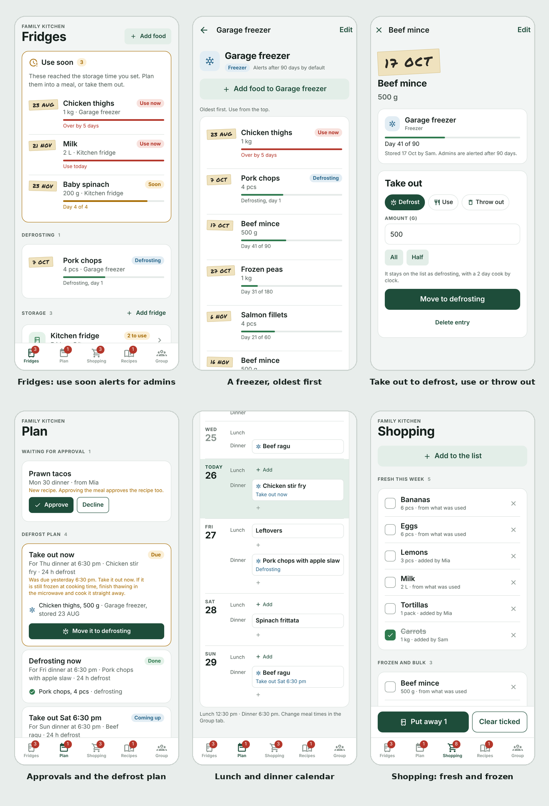

# NutriPlanner

A family meal planning app: shared fridges and freezers tracked oldest first, storage alerts, a lunch and dinner calendar with defrost timing, recipes, and a shopping list built from what was used.

Built with Expo SDK 58 (React Native, TypeScript) and Firebase (Authentication and Cloud Firestore, free Spark plan). Developed on Windows; runs on iPhone through Expo Go, on Android, and in a browser.

**New here? Start with [SETUP_WINDOWS.md](SETUP_WINDOWS.md).** The app runs in demo mode with sample data until Firebase is connected.



---

## What it does, against the brief

| Brief | How NutriPlanner does it |
|---|---|
| Personal login per person | Email and password accounts. A relaunch keeps you signed in. |
| Groups per team; creator is admin; invites; promote to admin | Whoever starts a group is its admin. Admins create a 6 character invite code (valid 7 days) and share it. Admins promote or demote anyone; a group always keeps at least one admin. |
| Admins edit fridges, add items, take items out to defrost or eat | Admins manage fridges and freezers, edit and delete items, and take any amount out as **defrost**, **use** or **throw out**. Partial amounts split off cleanly. |
| Members propose meals that an admin accepts | Members propose meals for a calendar slot and propose recipes. Admins approve or decline. Approving a meal that uses a new recipe approves the recipe too. |
| Track fridges and what is in each | Any number of fridges and freezers per group. Each lists its food with amount, unit and the date it went in. |
| Oldest first | Every list is first in, first out, with the storage date on a masking tape label. |
| Warning to admins after a manually set time | Each item has its own "alert admins after N days" (default set per fridge). Admins see a **Use soon** card and get phone reminders. Defrosting food gets a 2 day cook by clock. |
| Shopping list from what was consumed, split frozen and fresh | **Add what was used** turns everything logged as used into list lines, adds up repeats, converts units, and files each under **Fresh this week** or **Frozen and bulk** depending on where it was stored. Thrown out food is not added back. |
| Everyone can add to the list | Any member adds lines manually. |
| After shopping, put items into fridges | Tick what you bought, then **Put away**: choose the fridge per item; it is stored today. Any member can do this (agreed decision). |
| Shared calendar, lunch and dinner | Week view, Monday to Sunday, lunch and dinner per day, visible to everyone. |
| Plan meals and recommend when to take food out to defrost | Defrost hours live on the recipe (agreed decision). The **Defrost plan** shows each take out time, the oldest matching freezer item to use, and a one tap **Move to defrosting**. Overnight take out times move to 9 pm the evening before. |

---

## Architecture

```
src/
  app/            Screens (Expo Router). Each file is a route.
    (tabs)/       Fridges, Plan, Shopping, Recipes, Group
  core/           Pure TypeScript rules: units, dates, storage alerts, first in first out,
                  defrost planning, shopping generation, reminders, permissions, errors.
                  No React, no Firebase. Fully unit tested.
  data/
    store.ts            The document store interface every feature uses
    firebase-store.ts   Cloud Firestore implementation
    memory-store.ts     In memory implementation (demo mode and tests)
    services/           Every write the app makes, written once for both stores
  state/          React providers: session, live group data, device settings, reminders
  ui/             Theme tokens and shared components
firestore.rules   Server side permissions (the real enforcement)
rules-tests/      Security rules tests, run against the Firestore emulator
```

Rules of the codebase:

1. Screens never talk to Firebase. Screens call services; services call the store.
2. `core/` has no React and no Firebase, so it can be tested in milliseconds.
3. One error type (`AppError`) crosses layer boundaries; Firebase error codes are translated in `core/errors.ts` only.
4. Permissions are enforced by `firestore.rules`. `core/permissions.ts` mirrors them only to decide which buttons to show.
5. Colours, sizes and spacing come from `ui/theme.ts`.
6. Calendar days are stored as local `YYYY-MM-DD` strings, never UTC timestamps, so a Thursday dinner stays on Thursday.

### Data model (Firestore)

```
users/{uid}                       displayName, email, groupIds, activeGroupId
invites/{code}                    groupId, groupName, expiresAt          (get by code only, never listed)
groups/{groupId}                  name, lunchTime, dinnerTime, inviteCode
  members/{uid}                   displayName, role (admin | member), inviteCode used to join
  fridges/{id}                    name, kind (fridge | freezer), defaultAlertDays
  items/{id}                      fridgeId, name, quantity, unit, storedAt, alertAfterDays, status
  consumptions/{id}               what was used or thrown out; feeds the shopping list
  shopping/{id}                   name, quantity, unit, category (fresh | frozen), checked
  recipes/{id}                    ingredients, defrostHours, status (pending | approved | rejected)
  meals/{id}                      date, slot (lunch | dinner), recipeId, status (proposed | confirmed | rejected)
```

Units are a strict list: g, kg, ml, L, pcs, pack.

---

## Commands

| Command | What it does |
|---|---|
| `npm start` | Development server; scan the QR code with your iPhone camera |
| `npm run start:tunnel` | Same, when phone and PC are on different networks |
| `npm run web` | Open in the browser |
| `npm run demo` | Force demo mode even with Firebase configured |
| `npm run check` | Type check, lint and unit tests |
| `npm test` | 46 unit tests (domain rules and services) |
| `npm run test:rules` | Security rules tests on the emulator (needs Java 21) |
| `npm run emulators` | Local Auth and Firestore emulators for safe testing |
| `npm run deploy:rules` | Publish `firestore.rules` to your project |
| `npm run deploy:web` | Build the web app and publish it to Firebase Hosting |

---

## Status: prototype 0.2

### Verified

* 46 unit tests pass: units, dates (including daylight saving), first in first out, storage alerts, defrost planning, shopping generation, reminders, permissions, and every service against the in memory store.
* Type check and lint are clean.
* The web build and the iOS JavaScript bundle both compile. The iOS bundle contains a single copy of Firebase, the React Native build of Firebase Auth, and the phone version of the reminder code.
* A scripted browser run at phone size passes 23 of 23 flows in demo mode: admin and member roles, taking out, approvals, defrost plan, shopping generation and put away, invites, joining with a code, starting a new group, and data surviving a reload.

### Not yet verified

* **Security rules have not been executed.** The test suite is written; run `npm run test:rules` on your PC.
* **Not yet run on a physical iPhone.** The bundle builds; the first run in Expo Go is the real test.

### Known limits

* **Offline:** on phones, the Firebase JavaScript library caches in memory only, so after a restart the app needs a connection. A full offline cache needs React Native Firebase and a development build (no Expo Go).
* **Reminders** are scheduled on each admin's phone (the free plan has no server). A phone learns about changes made by others when the app is opened.
* **Last admin protection** is enforced by the app; Firestore rules cannot count admins.
* **Ingredient matching** for defrost suggestions compares names (plurals and contained words), so "Chicken" matches "Chicken thighs" but "Mince" does not match "Ground beef".
* Light mode only.

---

## Roadmap

1. Run the rules tests and a first Expo Go session on your iPhone; fix whatever the device shows.
2. Family trial on the free web app (Firebase Hosting).
3. Shopping list: also add what next week's planned meals need but storage lacks.
4. TestFlight build through EAS, for real phone reminders without the PC running.
5. Server reminders (Blaze plan, Cloud Functions) if phone side scheduling proves unreliable.
